<!--
  Public org profile for https://github.com/Mirmire-Launcher
  Lives in Mirmire-Launcher/.github → profile/README.md
-->

  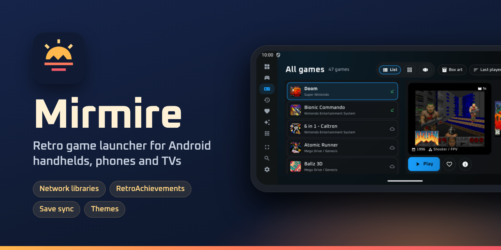

  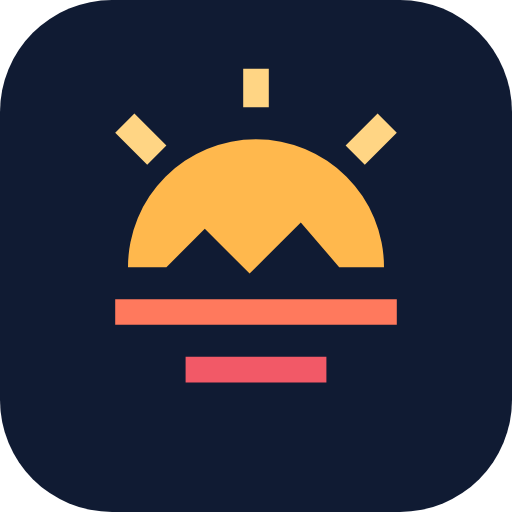

<h1 align="center">Mirmire</h1>

  <strong>Early dawn for your game library.</strong> 
  A controller-first Android launcher for ROMs on network storage — built for handhelds, phones, and TVs.

  
  &nbsp;
  
  &nbsp;
  

  <a href="https://github.com/Mirmire-Launcher/mirmire/releases/latest"><strong>Get the APK</strong></a>
  ·
  <a href="https://github.com/Mirmire-Launcher/mirmire">Releases &amp; notes</a>

---

### Screenshots

  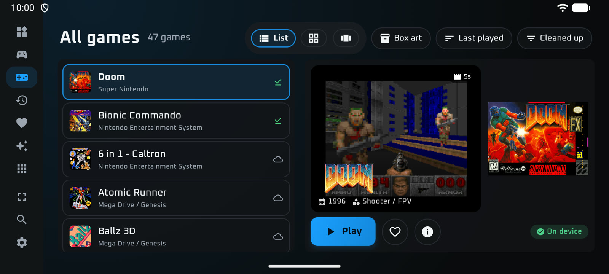

  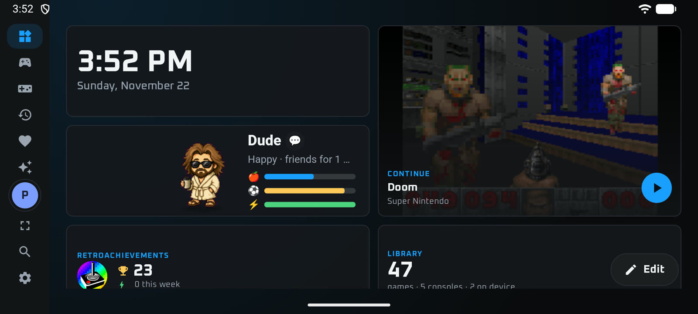
  &nbsp;
  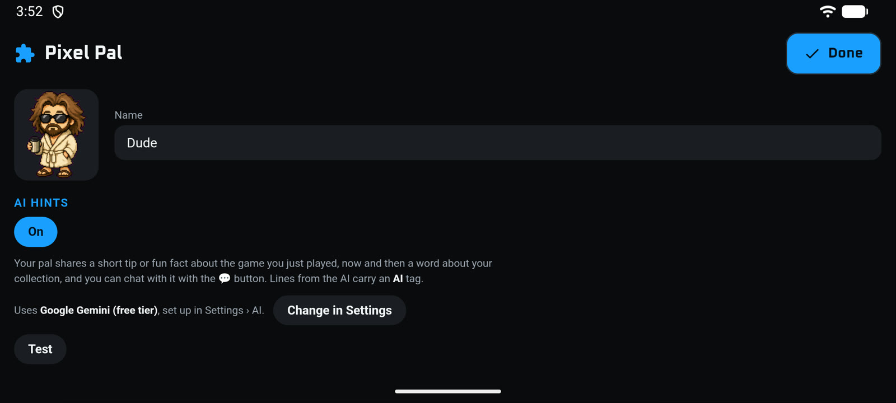

  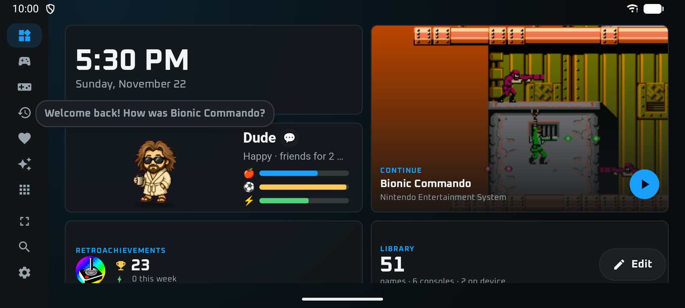
  &nbsp;
  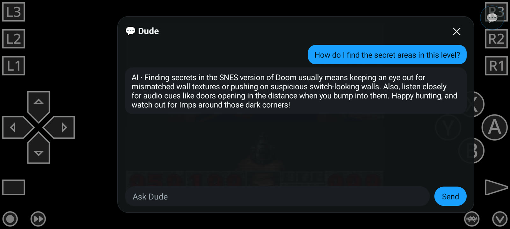

  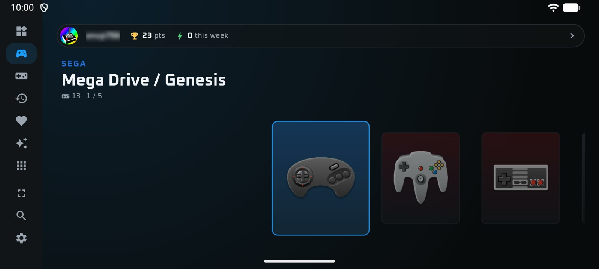
  &nbsp;
  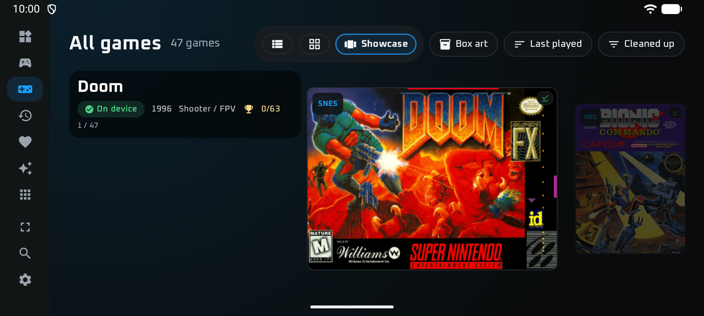

  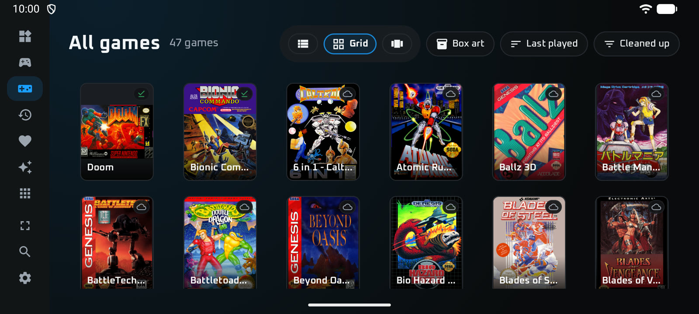
  &nbsp;
  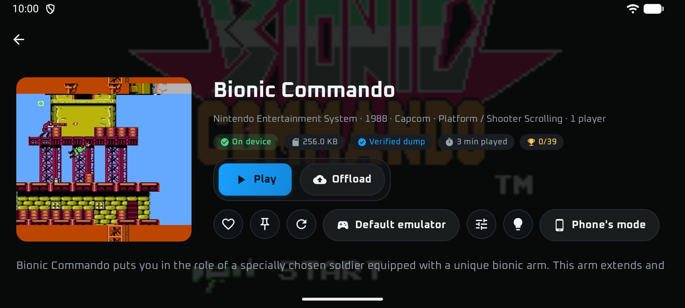

  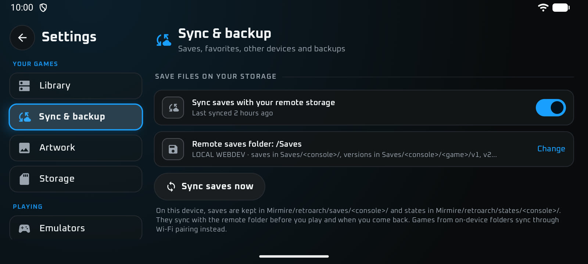
  &nbsp;
  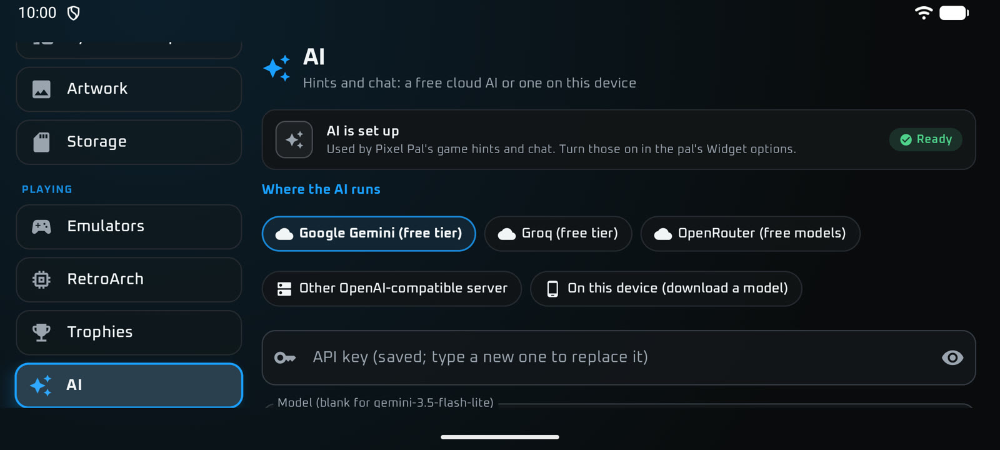

  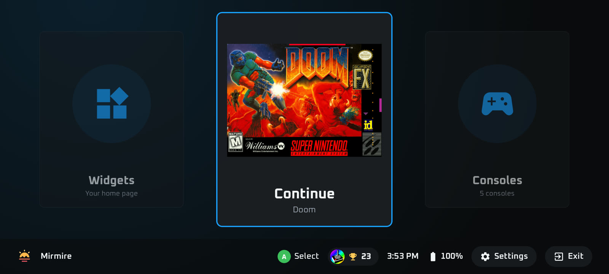
  &nbsp;
  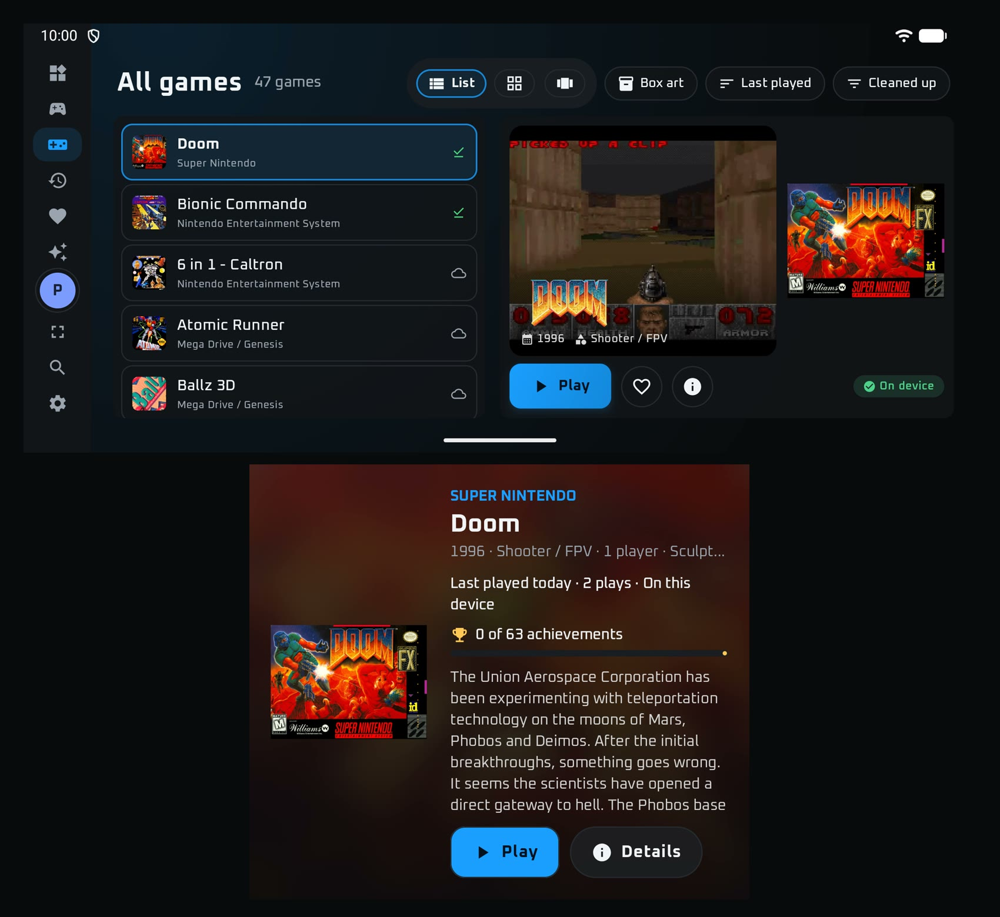

  Games list · Home · Pixel Pal · Welcome back · Chat in-game · Consoles · Showcase · Grid · Details · Sync &amp; backup · AI · Big Picture · Dual screen

---

### Why Mirmire

**Mirmire** means *early dawn* in Nepali — a quiet start before a long session. Keep your library on a NAS or server (or Drive/Dropbox via rclone), browse with a gamepad, scrape artwork lightly, sync saves, and launch into the emulator you already use.

| | |
|:---|:---|
| **Network libraries** | SMB, WebDAV, FTP, SFTP, RomM, and **rclone** for Google Drive / Dropbox / OneDrive; away from home through Tailscale |
| **Local ↔ storage** | Download on Play; upload local-only copies back to the NAS when missing |
| **Built for pads & TVs** | Focus-first UI, Showcase / grid / list layouts, Steam Deck–friendly chrome |
| **Emulator defaults** | DuckStation, Mupen64Plus FZ, WatermelonDS, ARMSX2 and friends when installed |
| **Themes** | First Light bundled; import ZIPs and console icon packs |
| **RetroAchievements** | Progress in the UI when you connect your account |
| **Saves** | Sync with your storage or through Syncthing; conflicts ask which save to keep |
| **BIOS checker** | Every file each emulator needs, checked by checksum, with the folder it belongs in |
| **Parental controls** | Age ratings, daily play time and a parent PIN for children's profiles |
| **PC streaming** | Moonlight, Artemis and Steam Link games in their own Streaming console |
| **Home Assistant** | Lights and scenes that follow what you play |
| **Bring your library** | Favorites, play time and collections from Pegasus and LaunchBox |
| **Pixel Pal & AI** | Companion on Home; optional tips, chat, and overlay while you play |
| **3D Big Picture** | Optional [Mirmire Cartouche](https://github.com/Mirmire-Launcher/mirmire-cartouche): consoles in 3D, games on their discs and cartridges, built on [Cartouche](https://github.com/Hakimba/cartouche) by Hakimba |

---

### Start here

1. Install the latest **[release APK](https://github.com/Mirmire-Launcher/mirmire/releases/latest)** on your Android device  
2. Add a library (network share or server) and let it scan  
3. Pick a theme under **Look**, map a player for each system, and play  

Updates can be installed from **Settings → System → App updates** once a build is published here.

---

### Repositories

| Repo | What it is |
|:---|:---|
| **[mirmire](https://github.com/Mirmire-Launcher/mirmire)** | Public downloads — signed APKs and release notes |
| **[mirmire-cartouche](https://github.com/Mirmire-Launcher/mirmire-cartouche)** | Mirmire Cartouche, the 3D Big Picture: a GPL fork of [Cartouche](https://github.com/Hakimba/cartouche), source and APKs |

---

  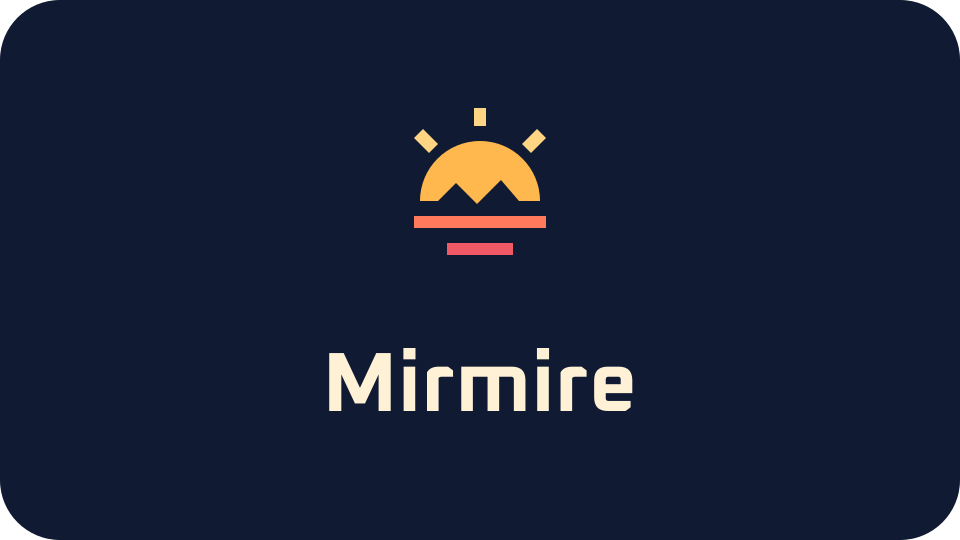

  Dawn blue · gold · coral · rose 
  <code>#101B33</code>&nbsp;&nbsp;<code>#FFB84D</code>&nbsp;&nbsp;<code>#FF795D</code>&nbsp;&nbsp;<code>#F25967</code>

Mirmire is a launcher only. It doesn't include or provide any games, ROMs or BIOS files: use it with games you own and have the right to play. Games appear in the screenshots for illustration only. DOOM is a registered trademark of id Software LLC, a ZeniMax Media company. Nintendo, Super Nintendo, Game Boy, Nintendo 64, SEGA, Mega Drive, Genesis, PlayStation, Xbox, Steam, RetroArch, and all other game titles, console names and trademarks belong to their respective owners. Game artwork comes from ScreenScraper and the Libretro thumbnail project and belongs to its respective owners. Mirmire is an independent project and isn't affiliated with or endorsed by any of these companies.

